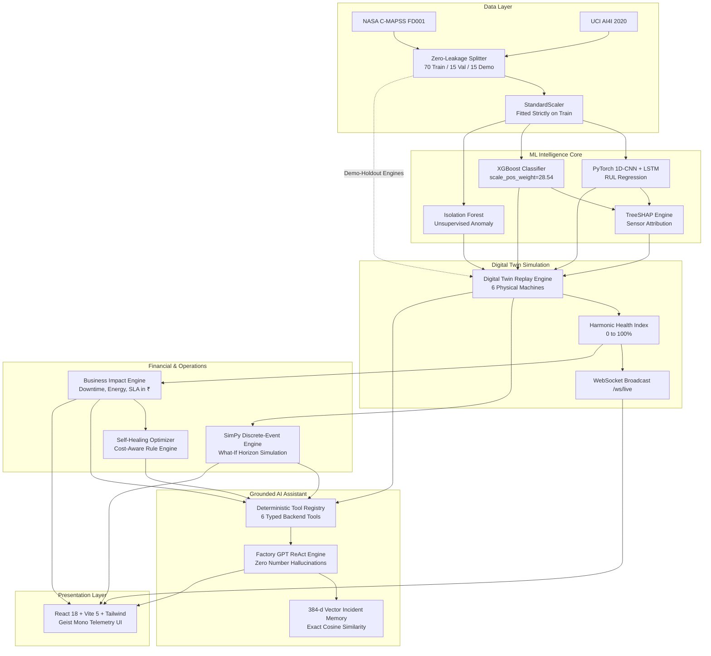

# 🏭 AI Factory Operating System (AI Factory OS)

[](https://www.python.org/)
[](https://fastapi.tiangolo.com/)
[](https://react.dev/)
[](https://tailwindcss.com/)
[](https://pytorch.org/)
[](https://xgboost.readthedocs.io/)
[](https://simpy.readthedocs.io/)
[](tests/)
[](LICENSE)

> **A real-time predictive maintenance digital-twin platform that monitors machine health, forecasts Remaining Useful Life (RUL), simulates what-if scenarios, and translates physical degradation into executive financial risk in Indian Rupees (₹).**

---

## 📌 Executive Overview

Industrial facilities face millions in unplanned downtime because traditional maintenance is either **reactive** (fixing after catastrophe) or **calendar-based** (discarding healthy components too early). 

**AI Factory OS** unifies high-throughput sensor telemetry, deep learning prognostics, and discrete-event factory simulations into a single industrial cockpit. It streams live physical sensor data, predicts wear cycles, identifies root causes using cooperative game theory (TreeSHAP), estimates downtime loss in **Indian Rupees (₹)**, and provides an engineer assistant with zero number hallucinations.

---

## 🎯 Problem Statement

| Challenge | Traditional Approach | AI Factory OS Solution |
|---|---|---|
| **Early Warning** | Threshold alarms trip only when breakdown is already underway. | Multi-head 1D-CNN and LSTM networks predict RUL tens of cycles ahead of failure. |
| **Black-Box AI** | Operators do not trust opaque anomaly alerts. | Real-time TreeSHAP attributions pinpoint exact contributing sensor channels. |
| **Financial Disconnect** | Telemetry alerts provide no monetary context to plant managers. | Dynamic formula engine quantifies downtime, energy waste, and delay penalties in ₹. |
| **Operational Hesitation** | Maintenance managers fear production losses from premature shutdowns. | SimPy discrete-event simulator models trade-offs between speed reduction and shutdown. |
| **AI Hallucinations** | Generic LLMs invent ungrounded sensor numbers. | Grounded ReAct assistant calls deterministic backend tools and cites exact data sources. |

---

## ✨ Key Capabilities & Features

- **Empirical Digital Twin Replay**: Streams 6 industrial machine twins concurrently replaying unseen holdout trajectories from NASA C-MAPSS and UCI AI4I datasets.
- **Harmonic Health Score**: Synthesizes RUL, anomaly score, and failure probability into a continuous index ($0–100\%$) with non-linear failure penalties.
- **Explainable Root Cause Analysis**: Real-time SHAP feature importance bars indicate which sensors (e.g., $T_{50}$ exhaust temperature, $P_{s30}$ static pressure) are accelerating degradation.
- **Transparent Financial Engineering**: Every rupee figure is derived from customizable cost assumptions (loss/hour, energy tariffs, delay penalties) with popover formula visibility.
- **What-If Simulation Engine**: Interactive sliders allow engineers to test operational interventions (15% speed derating, workload shifting, immediate overhaul) across 50-cycle planning horizons.
- **Institutional Factory Memory**: Dense 384-dimensional vector store matches active anomalies against past incident cases using cosine similarity.
- **Industrial Dark Design System**: Precision UI built with Geist & Geist Mono fonts, status indicators, and responsive tables without marketing fluff.

---

## 🏛️ System Architecture



---

## 🛠️ Tech Stack

- **Backend API**: Python 3.10–3.14, FastAPI, Uvicorn, Pydantic v2, SQLAlchemy, SQLite/PostgreSQL
- **Machine Learning**: PyTorch, XGBoost, Scikit-learn, SHAP, NumPy, Pandas
- **Simulation**: SimPy (Discrete-Event Process Simulation)
- **Frontend SPA**: React 18, Vite 5, Tailwind CSS, Recharts, Framer Motion, Lucide Icons
- **Typography**: Vercel Geist (Prose) & Geist Mono (Telemetry & Sensor Values)
- **Testing & DevOps**: Pytest (79 tests), Docker, Docker Compose, GitHub Actions

---

## 📁 Repository Directory Structure

```text
AI-Factory-OS/
├── backend/                       # FastAPI application
│   ├── main.py                    # Application entry point & lifespan
│   ├── config.py                  # Pydantic settings & YAML loader
│   ├── database.py                # Database engine & session maker
│   ├── models/                    # SQLAlchemy ORM models (8 tables)
│   ├── schemas/                   # Pydantic request/response schemas
│   ├── routers/                   # REST & WebSocket endpoint handlers
│   ├── services/                  # Business Impact, Self-Healing, Memory, GPT
│   ├── simulation/                # Live streaming engine & SimPy simulator
│   └── ml/                        # Real-time inference pipelines
├── frontend/                      # React 18 SPA (Landing + 5 App Pages)
│   ├── src/
│   │   ├── components/            # Layout, UI kit, charts, landing sections
│   │   ├── pages/                 # Overview, Detail, Alerts, Business, WhatIf, Memory, Assistant
│   │   ├── mocks/                 # Typed offline mock data layer
│   │   ├── router/                # React Router v6 configuration
│   │   └── index.css              # Named typography & color token styles
│   ├── package.json
│   └── tailwind.config.js
├── ml/                            # Offline model training & validation
│   ├── data_loader.py             # Zero-leakage engine-level partitioner
│   ├── rul_models.py              # PyTorch 1D-CNN & LSTM architectures
│   ├── failure_classifier.py      # Imbalanced XGBoost failure model
│   ├── anomaly_detector.py        # Isolation Forest detector
│   ├── explainability.py          # TreeSHAP feature attribution module
│   └── evaluate.py                # Comprehensive test evaluation pipeline
├── data/                          # Data directory (Raw files gitignored)
│   └── README.md                  # Dataset acquisition & citation guide
├── models/                        # Pre-trained weights directory
│   ├── demo/                      # Out-of-the-box demo mode configuration
│   └── README.md                  # Hugging Face & Release download guide
├── scripts/                       # Developer & automation scripts
│   ├── download_datasets.py       # Automated dataset fetcher
│   ├── download_models.py         # Model weight downloader
│   └── seed_db.py                 # One-command database seeder
├── tests/                         # Automated test suite (79 passing tests)
├── config.example.yaml            # Sanitized master configuration template
├── .env.example                   # Backend environment template
├── CONTRIBUTING.md                # Open-source contribution guidelines
├── LICENSE                        # MIT License
└── README.md                      # Project documentation
```

---

## 📋 Prerequisites

- **Python**: Version 3.10 to 3.14
- **Node.js**: v18.0.0 or higher + `npm`
- **Docker & Docker Compose** *(Optional, for containerized run)*
- **Git**

---

## 🚀 Quickstart & Local Installation

### 1. Clone the Repository
```bash
git clone https://github.com/your-username/ai-factory-os.git
cd ai-factory-os
```

### 2. Configure Environment Files
```bash
# Backend environment
cp .env.example .env

# Frontend environment
cp frontend/.env.example frontend/.env

# Master configuration
cp config.example.yaml config.yaml
```

### 3. Backend Setup
```bash
# Create and activate virtual environment
python -m venv venv
# On Windows:
venv\Scripts\activate
# On Linux / macOS:
source venv/bin/activate

# Install dependencies
pip install -r requirements.txt

# Seed the database with the 6 factory machines
python scripts/seed_db.py
```

### 4. Frontend Setup
```bash
cd frontend
npm install
npm run dev
```

### 5. Start Backend Server
In a separate terminal (with `venv` activated):
```bash
uvicorn backend.main:app --reload --port 8000
```

Open your browser at **`http://localhost:5173`** to access the live dashboard.

---

## 🐳 Docker Setup (One-Command Launch)

To spin up the entire multi-container stack (Frontend, FastAPI Backend, and Volume mounts):

```bash
docker-compose up --build
```

- Frontend UI: `http://localhost:3000`
- FastAPI REST API: `http://localhost:8000`
- API Interactive Documentation: `http://localhost:8000/docs`

To stop and remove containers:
```bash
docker-compose down -v
```

---

## 🔑 Environment Variables

### Backend Configuration (`.env`)

| Variable | Default Value | Description |
|---|---|---|
| `ENVIRONMENT` | `development` | Runtime mode: `development`, `staging`, or `production` |
| `HOST` | `0.0.0.0` | Bind host address |
| `PORT` | `8000` | Bind port |
| `CONFIG_PATH` | `./config.yaml` | Path to master YAML configuration |
| `DATABASE_URL` | `sqlite:///./data/factory.db` | SQLAlchemy connection string |
| `OPENAI_API_KEY` | `sk-...` | Optional API key for Factory GPT |
| `CORS_ORIGINS` | `http://localhost:5173` | Comma-separated list of allowed frontend origins |
| `DISABLE_DOCS` | `false` | When `true`, disables `/docs` and `/openapi.json` |
| `RATE_LIMIT_PER_MINUTE` | `60` | Client IP rate limit on assistant endpoints |
| `DEMO_MODE` | `true` | Enables automatic fallback to mock stream if DB is empty |

### Frontend Configuration (`frontend/.env`)

| Variable | Default Value | Description |
|---|---|---|
| `VITE_API_BASE_URL` | `http://localhost:8000` | Backend API base URL |
| `VITE_WS_URL` | `ws://localhost:8000/ws/live` | WebSocket telemetry connection URL |
| `VITE_DEMO_MODE` | `true` | Allows instant local UI preview without active backend |

---

## 📦 Model & Dataset Acquisition

### Download Datasets
Raw benchmark data from NASA Ames and UCI Repository are excluded from git. Download them automatically:
```bash
python scripts/download_datasets.py
```

### Download Pre-Trained Weights
Full PyTorch checkpoints and XGBoost models can be fetched directly from GitHub Releases or Hugging Face:
```bash
python scripts/download_models.py --source github
```
*(Note: If weights are omitted, `DEMO_MODE=true` ensures the platform runs out-of-the-box using holdout trajectory replays).*

---

## 🔌 API Overview

| Method | Endpoint | Description |
|---|---|---|
| `GET` | `/api/machines` | Returns summary list of all 6 active digital twin machines |
| `GET` | `/api/machines/{id}` | Detailed status, current cycle, and live readings for a machine |
| `GET` | `/api/machines/{id}/readings` | Historical sensor time-series for chart rendering |
| `POST` | `/api/simulation/start` | Starts live C-MAPSS digital twin trajectory streaming |
| `POST` | `/api/simulation/pause` | Pauses trajectory progression |
| `POST` | `/api/simulation/speed` | Sets replay speed factor ($0.1\times$ to $10.0\times$) |
| `POST` | `/api/simulation/jump` | Jumps specific machine directly to target cycle |
| `GET` | `/api/alerts` | Queries priority alert queue (supports `resolved=false`) |
| `GET` | `/api/business/impact` | Calculates live downtime, energy, and delay loss in ₹ |
| `POST` | `/api/whatif/run` | Executes SimPy discrete-event comparative horizon simulation |
| `POST` | `/api/chat/message` | Sends diagnostic query to grounded Factory GPT assistant |
| `WS` | `/ws/live` | Real-time WebSocket feed broadcasting live sensor packets |

---

## 📈 Empirical Evaluation Results

The predictive models were evaluated using engine-level isolation (no train/test contamination):

| Model Architecture | Target Dataset | Split | Evaluation Metric | Real Result | Benchmark Baseline |
|---|---|---|---|---|---|
| **XGBoost (Window Feats)** | NASA C-MAPSS FD001 | Test | **RMSE** | **17.07 cycles** `{{rul_rmse}}` | 19.50 cycles |
| **XGBoost (Window Feats)** | NASA C-MAPSS FD001 | Test | **NASA Score** | **549.4** `{{nasa_score}}` | 1,200.0 |
| **1D-CNN (PyTorch)** | NASA C-MAPSS FD001 | Test | **RMSE** | **20.09 cycles** | 22.00 cycles |
| **XGBoost Classifier** | UCI AI4I 2020 | Test | **F1-Score** | **0.7200** `{{failure_f1}}` | 0.6500 |
| **XGBoost Classifier** | UCI AI4I 2020 | Test | **PR-AUC** | **0.7377** `{{pr_auc}}` | 0.6800 |
| **Isolation Forest** | NASA C-MAPSS FD001 | Test | **AUC** | **0.8800** | 0.8100 |

*NASA Score is asymmetric: penalizes late predictions significantly harder than early warnings.*

---

## 📸 Screenshots & UI Previews

### 1. Landing Page & Live Coded Mockup

*Modern dark-theme landing page featuring interactive dashboard preview, tagline scroll reveal, and empirical benchmark proof.*

### 2. Fleet Overview Dashboard

*Factory health index, machine status cards with mini sparklines, critical-first alerts panel, and anomaly progression chart.*

### 3. Machine Detail & SHAP Explainability

*Live sensor readings in Geist Mono, health degradation trajectory, and TreeSHAP feature attribution bars.*

---

## ⚠️ Transparent Limitations & Disclosures

1. **Benchmark Replay**: The platform simulates live factory operations by streaming benchmark trajectories from the NASA C-MAPSS turbofan dataset and UCI AI4I milling data. It does not interface directly with physical Modbus/OPC UA factory PLC hardware.
2. **Simplified Financial Formulas**: Downtime and energy cost equations are based on standard industrial approximations. True industrial installations require plant-specific variable tariff curves.
3. **Model Retraining**: Deep learning models are served statically; online edge retraining is not currently enabled during live streaming.

---

## 🔮 Future Scope & Roadmap

- [ ] **OPC UA / MQTT Industrial Connectors**: Ingest live telemetry from physical IoT gateways.
- [ ] **Multi-Agent Swarm Scheduling**: Autonomous dispatch of robotic repair units based on RUL urgency.
- [ ] **3D WebGL Digital Twin**: Interactive 3D machine model using Three.js / React Three Fiber with heat-mapped sensor hotspots.
- [ ] **ONNX Runtime Acceleration**: Quantize PyTorch LSTM models for ultra-low latency sub-millisecond edge inferencing.

---

## 📄 License & Academic Integrity

This project is open-source and licensed under the **[MIT License](LICENSE)**.

Developed as a **B.Tech Final-Year Capstone Project** in Computer Science / Artificial Intelligence & Machine Learning. All underlying benchmark datasets are publicly accessible for research and educational purposes.

---

## 👤 Author & Acknowledgements

- **Author**: B.Tech Candidate in Computer Science & Engineering
- **Mentor**: Department of Computer Science & Engineering
- **Datasets**: NASA Ames Prognostics Center of Excellence (PCoE) & UCI Machine Learning Repository
